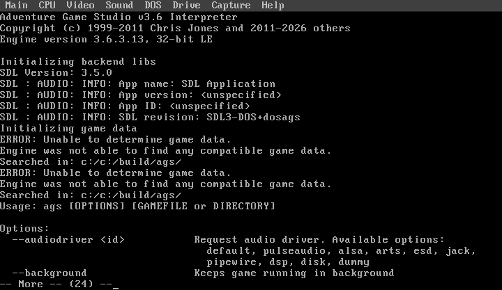
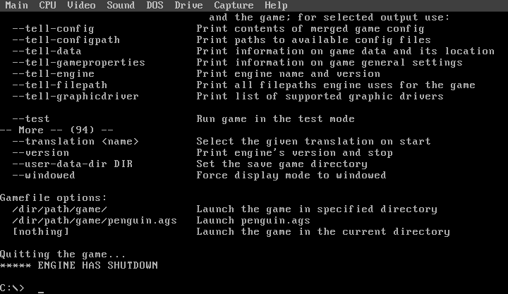

# DOSAGS

<p align="center">
<a href="#status">Status</a> | <a href="#game-assets">Game Assets</a> | <a href="#target-hardware">Target Hardware</a> | <a href="#building">Building</a> | <a href="#how-this-project-is-developed">How It's Developed</a> | <a href="#components-and-license">Components and License</a>
</p>

DOSAGS is a port of [Adventure Game Studio](https://github.com/adventuregamestudio/ags) (AGS) -- a general-purpose 2D point-and-click adventure engine, not a single game -- to MS-DOS on retro 486/Pentium-class hardware, using [SDL3](https://www.libsdl.org/)'s [DOS backend](https://github.com/libsdl-org/SDL/pull/15377), [DJGPP](https://www.delorie.com/djgpp/), and [CWSDPMI](https://en.wikipedia.org/wiki/DOS_Protected_Mode_Interface).

The name is a portmanteau of **DOS** and **AGS**, matching the naming convention of its sibling ports [doskutsu](https://github.com/ecliptik/doskutsu) (DOS + Doukutsu Monogatari) and [dossage](https://github.com/ecliptik/dossage) (DOS + Passage).

DOSAGS exists to prove the shared SDL3-DOS platform layer generalizes beyond a single hand-ported game to a real third-party *engine* -- the highest strategic-value, highest-difficulty candidate in the [sdl-dos-ports](https://forgejo.example.ts.net/ecliptik/sdl-dos-ports) hub's backlog, since a working engine port can potentially unlock many AGS games rather than just one.

This project is being built agentically using [Claude Code](https://claude.com/claude-code).

### Screenshots

| | |
|:---:|:---:|
|  |  |
| **Window surface, 8-bit INDEX8 (TITLE_SCREEN)** | **Window surface, 16-bit RGB565 (TITLE_SCREEN)** |
|  |  |
| **Boot + SDL3 init (STARTS)** | **Clean shutdown** |

<p align="center">The two <code>TITLE_SCREEN</code> captures are real 640x480 fullscreen-desktop frames pulled from DOSBox-X's own video capture (<code>F12+I</code>) -- a solid cleared surface is the <em>correct</em> result here, not a blank capture: this minimal synthetic game package (<code>tests/fixtures/minimal-game-package/</code>) has no sprites/rooms, so the window opens, clears to its background color, and presents with nothing drawn on top, exactly matching this milestone's own definition. 640x480 is the <em>window's</em> pixel size, not the game's rendering resolution -- the engine's own log confirms <code>Game native resolution: 320 x 240</code> every run (the v0.1 target); AGS auto-scales the window 2x to fit the desktop when nothing forces windowed mode, and <code>--windowed --gfxfilter stdscale 1</code> gets an exact 1:1 320x240 window instead (same code path, confirmed via a real run). The boot/shutdown captures are older STARTS-milestone frames from before any game package existed; the boot one is paused mid-stream via DOS's own <code>MORE</code> pager (hence the <code>-- More --</code> line) since the real output otherwise scrolls past in under a second under DOSBox-X.</p>

---

## Status

**The 486 performance gates are MET** (2026-09-30). On a real 486DX2-66 with
an ATI Mach64, measured through vcctrl with sound on, each colour depth holds
40 game ticks per second and 40 fps in play, twice:

| Depth | Fixture | Whole-run / steady ticks per second |
|---|---|---|
| 8-bit | Trilby's Notes room 35, 512x384 centred | 39.26 / 40.23 and 39.35 / 40.29 |
| 16-bit | 5 Days a Stranger room 3, 512x384 centred | 39.29 / 40.13 and 39.29 / 40.10 |
| 32-bit | 5 Days room 3 forced 32-bit, 640x480 centred | 39.28 / 40.12 and 39.34 / 40.07 |

The bar is both figures within 39.2-40.8. Every cell had clean audio
counters and a clean camera witness. A scored 640x480 capture listen passed
at each depth, and the WaveBlaster General MIDI arm passed at each depth. The
margins are thin (0.06-0.15), n=2, and the evidence spans four binaries;
[`STATUS.md`](./STATUS.md) has the caveats and binaries. One target failed:
cold-start sound latency was 4.30 ms (median) against a 1.0 ms target (D2).

Since then (2026-11-04):
- a **release build flavour** without the timing instrumentation
  (`make DOSAGS_RELEASE=1`);
- `make dist`, which packages it as a player zip checked against the
  licence records.

Both flavours pass the DOSBox-X ratchet. Next is a real-hardware A/B to
confirm the release flavour holds the gates, then v0.1
([`PLAN-NEXT.md`](./PLAN-NEXT.md)).

Where things live:
- [`PLAN-NEXT.md`](./PLAN-NEXT.md): the current work order.
- [`PLAN.md`](./PLAN.md) and [`PLAN-GATES.md`](./PLAN-GATES.md): the plan
  of record and the gate bar.
- [`PLAN-LOG.md`](./PLAN-LOG.md): the chronological log.
- [`STATUS.md`](./STATUS.md): the machine-readable state and every
  measured cell.
- [`PATCH-SEQUENCE.md`](./PATCH-SEQUENCE.md): the patch-by-patch record.

---

## Game Assets

**DOSAGS will ship no AGS game data**, ever -- including whichever small game eventually gets chosen for engine bring-up (see `PLAN.md`'s first-test-game selection criteria). AGS is a general-purpose engine: you bring your own legally obtained AGS game. See [LICENSE-REVIEW.md](./LICENSE-REVIEW.md).

---

## Target Hardware

The measured reference machine is a Gateway 2000 with a 486DX2-66, 48 MB of
RAM, an ATI Mach64 (2 MB, VESA via UniVBE 6.70), and a PicoGUS as a Sound
Blaster 2.0 with OPL3 and a WaveBlaster General MIDI daughterboard, running
MS-DOS 6.22.

- **CPU:** 486DX2-66 or faster. The gates above were measured here; heavier
  games and rooms can run below 40.
- **RAM:** 16 MB is the target minimum (not measured below 48 MB).
- **Video:** VESA for 512x384 and 640x480. 8-, 16- and 32-bit colour, all
  software rendering.
- **Sound:** Sound Blaster compatible for PCM. MIDI goes to OPL3/OPL2 (the
  default), MPU-401/WaveBlaster, or a Gravis UltraSound, chosen with
  `SDL_HINT_DOS_AUDIO_BACKEND`.
- **OS:** MS-DOS 6.22 or compatible.

**PicoGUS + WaveBlaster daughterboard (e.g. DreamBlaster S2) in Sound Blaster mode:** add
`SET SDL_HINT_DOS_AUDIO_WB_TX_DELAY=0` and `SET SDL_HINT_DOS_AUDIO_WB_DRR_POLL=0` to the boot
profile that runs the PicoGUS as a Sound Blaster. The PicoGUS firmware's MPU-401 emulation buffers
the bytes it forwards to the header, so the per-byte pacing a real SB16's MPU needs only costs time
here (measured on a 486DX2-66, 2026-09-24: music clean with both off). Do NOT set them when a
Creative SB16/AWE's own MPU feeds the header: that path garbles without the pacing. An automatic
rule is planned to replace this.

**Mouse:** the game reads the mouse driver only after a mouse interrupt (SDL patch 0240), which
saves ~1.5 ms a tick on a 486DX2-66. If a mouse misbehaves with it (for example a driver that does
not report its IRQ correctly), `SET SDL_HINT_DOS_MOUSE_POLL=1` is the field fallback: it polls the
driver on every event pump, as before.

### To build (a Linux or macOS host)

Needs:
- the [DJGPP cross-compiler](https://github.com/andrewwutw/build-djgpp)
  (`i586-pc-msdosdjgpp-gcc`, GCC 12.2.0);
- `cmake`, `git`, `make`, `gcc`, `python3`, `zip`;
- `dosbox-x`, to run the build and the test harness locally (see
  `.sdl-dos-ports/shared/skills/dos-emulator-workflow/`).

```bash
git clone https://forgejo.example.ts.net/ecliptik/dosags.git
cd dosags

./scripts/setup-symlinks.sh     # one-time: link tools/djgpp if using the ~/emulators hub
./scripts/fetch-sources.sh      # SDL3 and AGS at their pinned SHAs
./scripts/apply-patches.sh      # apply patches/SDL/ and patches/ags/

make                            # instrumented build: build/ags/ags.exe (what the tests and gates run)
make DOSAGS_RELEASE=1 game      # release build: build/ags-release/ags.exe
make dist                       # release build + player zip: build/dist/dosags-dev.zip
```

`make dist` needs CWSDPMI r7 unpacked into `vendor/cwsdpmi/` (pinned by
sha256 in `vendor/binaries.manifest`). It checks the zip with
`scripts/check-dist.sh`. `make DOSAGS_RELEASE=1 build-dirty` prints a
build's stamp. The DOSBox-X ratchet (`tests/ratchet.yaml`, run by the hub's
`shared/tools/ratchet.sh`) is the regression gate for every landing.

The shared SDL3-DOS platform layer lives at `.sdl-dos-ports/` and is vendored into this repository as a **git subtree**, so it arrives with the clone -- there is no submodule to initialise. To pull later hub changes into it:

```bash
git subtree pull --prefix=.sdl-dos-ports \
  https://forgejo.example.ts.net/ecliptik/sdl-dos-ports.git main --squash
```

Each such commit records the exact upstream hub SHA in its own message (`Squashed '.sdl-dos-ports/' content from commit <sha>`), which is what makes "this binary came from this patch series" checkable.

See `.sdl-dos-ports/docs/` for the shared architecture/video/audio/input/filesystem/timing/optimization/testing docs this port follows.

---

## How This Project Is Developed

DOSAGS is developed agentically with [Claude Code](https://claude.com/claude-code):

- **Claude Code authors the patches** across the SDL3 DOS backend and the AGS engine. They land as `patches/<vendor>/NNNN-*.patch` files in this repository.
- **Human developers drive testing and iteration**: real-hardware playthroughs (once there's something to play), bug reports, and deciding what to fix next.
- **Workspace-local patches only.** This project does not contribute patches upstream to [libsdl-org/SDL](https://github.com/libsdl-org/SDL) or [adventuregamestudio/ags](https://github.com/adventuregamestudio/ags).

---

## Components and License

DOSAGS's own source -- the build system, scripts, harness and docs -- is
**MIT-licensed** ([LICENSE](./LICENSE)). The binary combines it with
**Artistic-License-2.0** AGS engine code (a Modified Version: `patches/ags/`),
**zlib** SDL3, and the libraries AGS carries.
[LICENSE-REVIEW.md](./LICENSE-REVIEW.md) records how each licence was read,
and [THIRD-PARTY.md](./THIRD-PARTY.md) lists every component and the player
zip's contents.

| Component | Purpose | License | In `AGS.EXE` |
|---|---|---|---|
| [DOSAGS port source](./LICENSE) (this repo) | Build system, patches, scripts, docs | MIT | Partly: the hub's shared modules |
| [Adventure Game Studio](https://github.com/adventuregamestudio/ags) | The engine, by Chris Jones and contributors | [Artistic License 2.0](https://github.com/adventuregamestudio/ags/blob/master/License.txt) | Yes |
| [SDL3](https://www.libsdl.org/) | Platform layer and its [DOS backend](https://github.com/libsdl-org/SDL/pull/15377) | [zlib](https://github.com/libsdl-org/SDL/blob/main/LICENSE.txt) | Yes |
| Allegro 4.4.3, FreeType 2.1.3, AllegroFont, aastr, miniz, stb_image, GLM | Carried inside AGS's tree | giftware / FreeType License / MIT | Yes |
| [DJGPP](https://www.delorie.com/djgpp/) libc, GCC runtime | 32-bit DOS C and C++ runtime | [copying.dj](https://www.delorie.com/djgpp/v2faq/faq19_1.html), [GCC Runtime Library Exception](https://www.gnu.org/licenses/gcc-exception-3.1.html) | Yes |
| [CWSDPMI](https://sandmann.dotster.com/cwsdpmi/) r7 | DPMI host, by Charles W. Sandmann | freeware, redistributable with CWSDPMI.DOC | No -- ships beside it |
